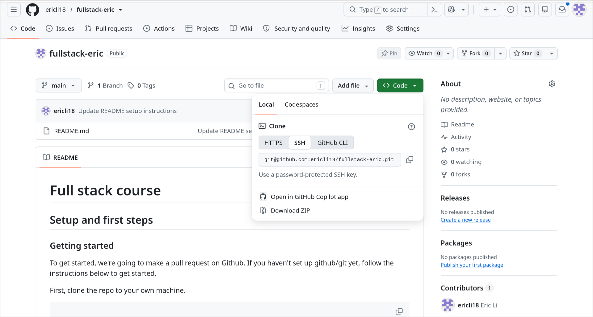
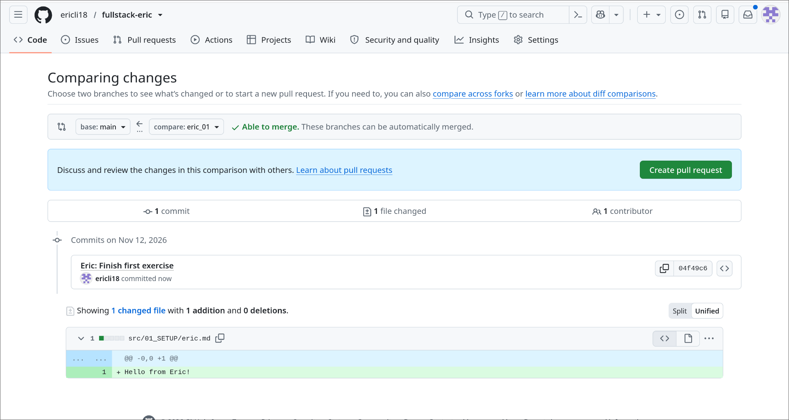

# Full stack course

## Setup and first steps

### Getting started
To get started, we're going to make a pull request on GitHub. If you haven't set up GitHub/git yet, [follow the instructions below](#first-time-git-setup) to get started.

First, clone the repo to your own machine. If you don't know how:

1. Find the repository cloning url by clicking **Code**, then **Copy** the URL.
> [!NOTE]
> If you connected below with SSH, make sure to switch to the **SSH** tag.



2. Run the following:
```sh
git clone <copied_url>
```

`git clone` copies the folder on GitHub onto your machine. If you don't get that, just run this command for now:

```sh
git clone git@github.com:ericli18/fullstack-eric.git
```

Create and checkout a new branch

```sh
git checkout -b your_name_01
```

Then, make a new file in `src/01_SETUP` named `your_name.md`, with any text in it.

```sh
git add .
git commit -m "Eric's first commit"
git push --set-upstream origin your_name_01
```

If `git push` fails, let me know. It means you don't have the permissions necessary from my side.

Open a pull request (pull requests>New pull request)

The base branch is main, the compare is going to be `your_name_01`. You should see something like this:



Just open the pull request

### First time git setup
#### Github account + install git
Just make one + probably google this

#### Setting up git
The commands below will configure your information for git (for linux/macos). Use your own name obv.

```sh
git config --global user.name "Eric Li"
git config --global user.email "eric.li.8736@gmail.com"

git config --global init.defaultBranch main

# If you are on macOS, remove the annoying DS_STORE meta files
echo .DS_Store >> ~/.gitignore_global
git config --global core.excludesfile ~/.gitignore_global
```

Verify that things are working

```sh
git config --get user.name
git config --get user.email
```

### Link git to github
```sh
# If this **returns** "No such file or directory"
ls ~/.ssh/id_ed25519.pub
# Then, run this, just hit enter enter enter take all defaults
ssh-keygen -t ed25519
```

**On Github.com**
Go to Profile>Settings>SSH and GPG Keys>New SSH key

Name it whatever you want, key type is authentication key, and past in the result from
```sh
cat ~/.ssh/id_ed25519.pub

# TO automatically copy on linux
cat ~/.ssh/id_ed25519.pub | wl-copy

# To automatically copy on macOS (I think)
cat ~/.ssh/id_ed25519.pub | pb-copy
```

Now follow [github's instructions for testing](https://docs.github.com/en/authentication/connecting-to-github-with-ssh/testing-your-ssh-connection?platform=linux)
